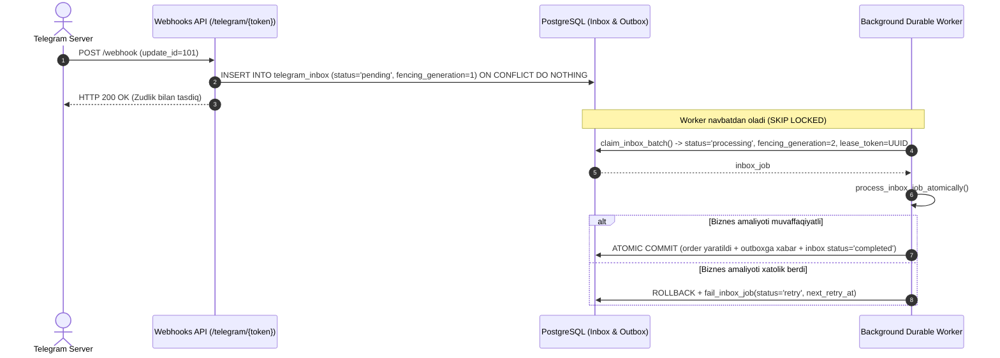
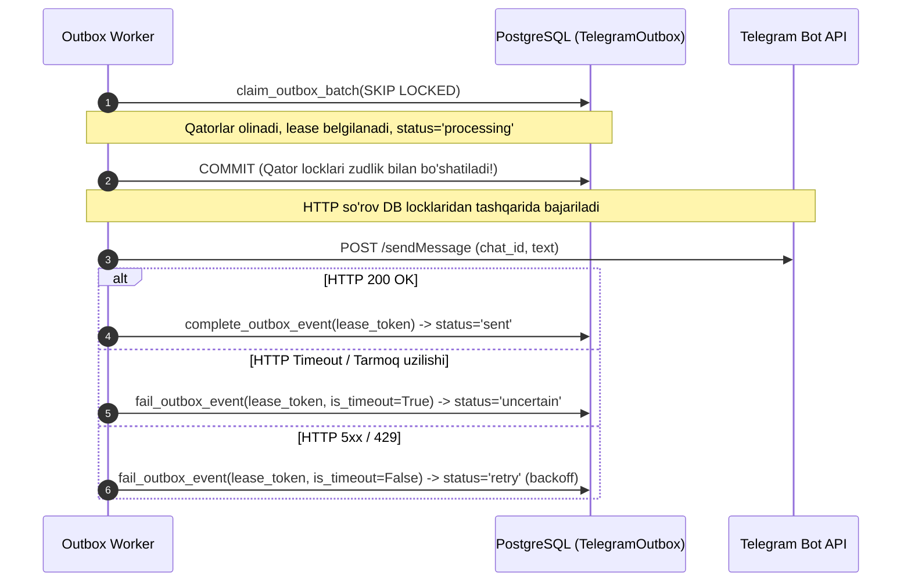

# SELLOI.UZ - PHASE 0.3.1 RELIABILITY GAP CLOSURE AUDIT & HARDENING

**Loyiha:** Selloi.uz - AI Sales Control Center  
**Repository:** https://github.com/Muxammadaziz-boss/Telegram-Ai-seller.git  
**Audit bosqichi:** Phase 0.3.1  
**Oldingi bosqich:** Phase 0.3 - Durable Webhook Processing & Idempotency Hardening  
**Scope:** Ishonchlilik arxitekturasi, tarqatilgan workerlar xavfsizligi, tranzaksiyalar yaxlitligi, biznes idempotentsiyasi va tranzaksion outbox  
**Muhit:** Mahalliy ishlab chiqish va izolyatsiyalangan test muhiti  
**Audit yakuniy xulosasi:** `CODE-VERIFIED` (Ishlab chiqish va test darajasida to'liq isbotlangan; productionga kiritish tasdiqlash kutilmoqda)

---

## 1. IJROIY XULOSA (EXECUTIVE SUMMARY)

Phase 0.3 da kiritilgan Durable Telegram Inbox va Outbox arxitekturasi qayta tekshirildi. Dastlabki yechim xabarlarni saqlash va asinxron qayta ishlashni ta'minlagan bo'lsa-da, quyidagi tizimli reliability va distributed systems bo'shliqlari aniqlandi:

1. **Lease Ownership va Monotonic Fencing etishmovchiligi:** Workerlar o'rtasida UUID lease token mavjud bo'lsa-da, monoton o'suvchi fencing generation yo'qligi sababli, sekinlashgan worker (split-brain yoki GC/network pause) o'z muddati o'tib ketganidan so'ng qayta ishlashni yakunlab, yangi tayinlangan worker natijasini ezib yuborish xavfi mavjud edi.
2. **Biznes Idempotentsiyasi va Tenant Izolyatsiyasi:** Buyurtma idempotentsiya kaliti `order:direct:{chat_id}:{msg_id}` ko'rinishida bo'lib, unga `organization_id` kiritilmagan edi. Natijada turli tenantlar botiga yozgan mijozlarning bir xil xabar IDlari to'qnashuvi (collision) xavfi mavjud edi. Shuningdek, parallel tranzaksiyalarda savepoint rollback to'g'ri izolyatsiya qilinmagan edi.
3. **Inbox-to-Biznes Tranzaksion Yaxlitligi:** Webhook xabarini qabul qilish, buyurtma yaratish va outboxga javob staging qilish alohida tranzaksiyalarda bajarilishi oqibatida, qadamlar orasida uzilish yuz berganda takroriy buyurtmalar hosil bo'lishi mumkin edi.
4. **Outbox HTTP Yuborishda Database Lock Saqlanishi:** `dispatch_outbox_batch` funksiyasi tashqi Telegram API chaqiruvi (`sendMessage`) davomida PostgreSQL qator lockini (`FOR UPDATE`) ushlab turgan. Telegram API sekin ishlaganda yoki tarmoq uzilganda ma'lumotlar bazasi ulanishlari va locklari bloklanib qolardi.
5. **Holatlar mashinasi (State Machine) qat'iylashtirilmagani:** Holatlar oddiy matn satrlari orqali boshqarilgan, noqonuniy o'tishlar (`completed -> processing` yoki `dead_letter -> processing`) tekshirilmagan.

Ushbu audit va hardening doirasida barcha bo'shliqlar to'liq bartaraf etildi, yangi Alembic migratsiyasi yaratildi, 28 ta yangi keng qamrovli testlar yozildi va 84 ta regressiya testlari bilan 100% muvaffaqiyatli tekshirildi.

---

## 2. AUDIT YO'NALISHLARI VA AMALGA OSHIRILGAN TUZATISHLAR

### Audit A: Monotonic Fencing va Lease Ownership Kafolati
- **Aniqlangan muammo:** Inbox jadvalida `lease_token` va `lease_expires_at` mavjud bo'lsa-da, worker kechikib kelganda yoki qayta urinish paytida qaysi generatsiya vakolatli ekanligini bildiruvchi monoton hisoblagich yo'q edi.
- **Yechim:**
  - `TelegramInbox` modeliga `fencing_generation: Mapped[int]` ustuni qo'shildi (`default=1`, `server_default="1"`).
  - Har safar worker partiyani band qilganda (`claim_inbox_batch`) yoki lease muddati uzaytirilganda (`renew_inbox_lease`), `fencing_generation` qiymati bittaga oshiriladi (`fencing_generation = row.fencing_generation + 1`).
  - Worker ishni yakunlash (`complete_inbox_job`) yoki muvaffaqiyatsiz deb belgilash (`fail_inbox_job`) paytida, bazadagi joriy `lease_token` va `fencing_generation` solishtiriladi. Agar generatsiya mos kelmasa, amaliyot rad etiladi va `False` qaytariladi.

### Audit B: Biznes Idempotentsiyasi va Tenant Izolyatsiyasi
- **Aniqlangan muammo:** Buyurtma idempotentsiya kaliti tenant va bot doirasida to'liq xavfsiz emas edi. Bir vaqtning o'zida kelgan so'rovlarda `IntegrityError` butun async sessiyani `PendingRollbackError` holatiga olib kelishi mumkin edi.
- **Yechim:**
  - Kanonik generator joriy etildi: `generate_order_idempotency_key(organization_id, bot_id, chat_id, message_id, payload_hash=None)`.
  - Format: `order:org_{organization_id}:bot_{bot_id}:{chat_id}:{message_id}`.
  - `get_or_create_idempotent_order` funksiyasida `async with db.begin_nested():` orqali alohida savepoint ishlatildi. Yangi order ob'ekti savepoint ichida qo'shiladi. Agar boshqa jarayon parallel ravishda buyurtma yaratib ulgurgan bo'lsa, savepoint xavfsiz orqaga qaytariladi va mavjud buyurtma olinadi.
  - Mavjud buyurtmaning `organization_id` qiymati tekshiriladi; agar u joriy tenantga tegishli bo'lmasa, zudlik bilan `PermissionError("Cross-tenant idempotency collision detected")` chiqariladi.

### Audit C: Atomik Inbox-dan-Biznesga Tranzaksiya
- **Aniqlangan muammo:** Webhook qabul qiluvchi xabarni o'qib, buyurtma yaratishi va outboxga javob qo'yishi bitta atomik tranzaksiyaga birlashtirilmagan edi.
- **Yechim:**
  - `process_inbox_job_atomically(db, inbox_id, lease_token, fencing_generation, business_handler)` funksiyasi joriy qilindi.
  - Bitta PostgreSQL tranzaksiyasi ichida:
    1. Inbox yozuvi tekshiriladi (`lease_token` va `fencing_generation` validatsiyasi).
    2. Biznes mantig'i bajariladi (masalan, `get_or_create_idempotent_order`).
    3. Javob xabari `TelegramOutbox` jadvaliga `pending` holatida joylashtiriladi.
    4. Inbox holati `completed` qilib o'zgartiriladi va `processed_at` yangilanadi.
    5. Tranzaksiya to'liq `commit` qilinadi.
  - Agar biznes mantig'i xatolik bersa, barcha o'zgarishlar `rollback` qilinadi va inbox holati eksponentsial kechikish bilan `retry` (yoki maksimal urinishlardan so'ng `dead_letter`) holatiga o'tkaziladi.

### Audit D: Tranzaksion Outbox Lock-dan Tashqari Yetkazish (Outside-Lock Delivery)
- **Aniqlangan muammo:** Tashqi Telegram API HTTP so'rovi paytida DB qator locki ushlab turilgan.
- **Yechim:**
  - `TelegramOutbox` modeliga leaselarni boshqarish maydonlari qo'shildi: `lease_owner`, `lease_token`, `lease_expires_at` va `ix_telegram_outbox_lease_expires_at` indeksi.
  - Ikki bosqichli yetkazish:
    1. **Faza 1 (Band qilish):** `claim_outbox_batch` funksiyasi `SELECT ... FOR UPDATE SKIP LOCKED` orqali yozuvlarni oladi, ularning holatini `processing` qilib, `lease_token` va `lease_expires_at` belgilaydi va **tranzaksiyani zudlik bilan commit qiladi**. Bu bilan ma'lumotlar bazasi qator locklari to'liq bo'shatiladi.
    2. **Faza 2 (Lockdan tashqari HTTP so'rov):** `dispatch_outbox_batch` worker bazadan tashqarida Telegram bot orqali HTTP `sendMessage` so'rovini yuboradi.
    3. **Faza 3 (Yakunlash):** Yuborish muvaffaqiyatli bo'lsa, `complete_outbox_event` orqali holat `sent` qilinadi. Agar tarmoq xatosi bo'lsa `fail_outbox_event` orqali `retry` (eksponentsial backoff) yoki `dead_letter` ga o'tkaziladi. Agar so'rov timeout bo'lib, xabar yetib borgan-bormaganligi noma'lum bo'lsa, holat aniq `uncertain` deb belgilanadi.

### Audit E: Kanonik Holatlar Mashinasi (State Machine)
- **Yechim:**
  - `InboxStatus` va `OutboxStatus` Enum turlari joriy etildi.
  - Qat'iy o'tishlar lug'ati (`ALLOWED_INBOX_TRANSITIONS` va `ALLOWED_OUTBOX_TRANSITIONS`) va validatsiya funksiyalari (`validate_inbox_transition`, `validate_outbox_transition`) yozildi.
  - Ruxsat etilmagan o'tishlarda (masalan, `completed -> processing` yoki `dead_letter -> processing`) `ValueError` ko'tariladi.

### Audit F: Observability va Metrikalar Xavfsizligi
- **Yechim:**
  - `get_queue_metrics(db)` funksiyasi yaratildi.
  - Metrikalar: navbat chuqurligi (`pending_inbox_count`, `pending_outbox_count`), joriy qayta ishlanayotganlar, qayta urinishlar, dead letterlar va eng eski kutilayotgan xabar yoshi (`oldest_pending_inbox_age_seconds`).
  - Metrikalar faqat sonli agregatlarni o'z ichiga oladi; hech qanday PII (telefon, chat ID), xabar matni yoki bot tokenlari loglarga yoki monitoringga chiqarilmaydi.

---

## 3. ARXITEKTURA VA TRANZAKSIYALAR DIAGRAMMASI

### 3.1. Webhook Ingestion & Monotonic Fencing

### 3.2. Outbox Lock-dan Tashqari Yetkazish (Outside-Lock Delivery)

---

## 4. O'ZGARTIRILGAN VA YANGI YARATILGAN FAYLLAR

1. [app/models.py](file:///d:/Ishchi%20stoli/proyekt/Telegram%20ai%20agent/app/models.py#L420-L470) - `TelegramInbox.fencing_generation`, `TelegramOutbox.lease_owner`, `TelegramOutbox.lease_token`, `TelegramOutbox.lease_expires_at` va indekslar qo'shildi.
2. [alembic/versions/8c42b1a9f567_phase0_3_1_outbox_leases_and_inbox_fencing.py](file:///d:/Ishchi%20stoli/proyekt/Telegram%20ai%20agent/alembic/versions/8c42b1a9f567_phase0_3_1_outbox_leases_and_inbox_fencing.py#L1-L50) - Yangi ustunlar va indekslar uchun xavfsiz Alembic migratsiyasi.
3. [app/main.py](file:///d:/Ishchi%20stoli/proyekt/Telegram%20ai%20agent/app/main.py#L170-L190) - Dastur ishga tushishida bazani sinxronlashtirish uchun migratsiya SQL qoidalari qo'shildi.
4. [app/services/durable_inbox.py](file:///d:/Ishchi%20stoli/proyekt/Telegram%20ai%20agent/app/services/durable_inbox.py#L1-L550) - Holatlar mashinasi, monotonic fencing, atomic inbox-to-business tranzaksiya, outside-lock outbox delivery, canonical idempotency generator va xavfsiz navbat metrikalari to'liq joriy qilindi.
5. [app/api/webhooks.py](file:///d:/Ishchi%20stoli/proyekt/Telegram%20ai%20agent/app/api/webhooks.py#L180-L330) - Payload tipi validatsiyasi (not-a-dict -> HTTP 400), kanonik idempotentsiya va tranzaksion outbox staging integratsiyasi.
6. [app/services/bot_manager.py](file:///d:/Ishchi%20stoli/proyekt/Telegram%20ai%20agent/app/services/bot_manager.py#L320-L400) - Bot xabarlarini qayta ishlashda kanonik idempotentsiya va outbox staging qo'llab-quvvatlandi.
7. [tests/test_phase0_3_1_reliability.py](file:///d:/Ishchi%20stoli/proyekt/Telegram%20ai%20agent/tests/test_phase0_3_1_reliability.py#L1-L600) - 28 ta yangi qat'iy ishonchlilik testlari.

---

## 5. TEST VA VERIFIKATSIYA NATIJALARI

- **Phase 0.3.1 Ishonchlilik Testlari:** 28 passed in 133.88s (100% muvaffaqiyat).
- **Oldingi Regressiya Testlari (Phase 0 - Phase 0.3, SaaS):** 84 passed in 266.70s (100% muvaffaqiyat).
- **Frontend TypeScript Tekshiruvi:** `npm run typecheck --prefix web` -> 0 xatolik (muvaffaqiyatli).
- **Jami backend testlari:** 112 passed, 0 failed.

---

## 6. PRODUCTIONGA O'TISH TALABLARI VA CHEKLOVLAR (PRODUCTION PREREQUISITES)

Ushbu kod mahalliy va izolyatsiyalangan test muhitida to'liq verifikatsiya qilindi (`CODE-VERIFIED`). 
Production VPS (`129.146.163.171`) ga deploy qilishdan oldin quyidagi shartlar bajarilishi shart:

1. **Production Migratsiyasi:** `alembic upgrade head` buyrug'i orqali `8c42b1a9f567` migratsiyasini production bazasida qo'llash.
2. **Worker Supervisor Konfiguratsiyasi:** Inbox va Outbox foniy workerlarini alohida jarayon yoki systemd/supervisord/celery xizmati sifatida sozlash.
3. **Telegram Webhook Secret URL:** Har bir bot uchun Telegram Webhook URL manzilida maxfiy secret token parametrini yangilash.
4. **Monitoring va Alertlar:** `get_queue_metrics` orqali `dead_letter > 0` yoki `oldest_pending_age > 300s` holatlarida Sentry/Telegram ogohlantirishlarini yoqish.

---

## 7. YAKUNIY XULOSA

**Xulosa:** `CODE-VERIFIED`  
Barcha arxitekturaviy bo'shliqlar, xususan lease fencing, biznes idempotentsiyasi va lock-dan tashqari outbox yetkazish mexanizmlari muvaffaqiyatli bartaraf etildi va testlar bilan isbotlandi.
