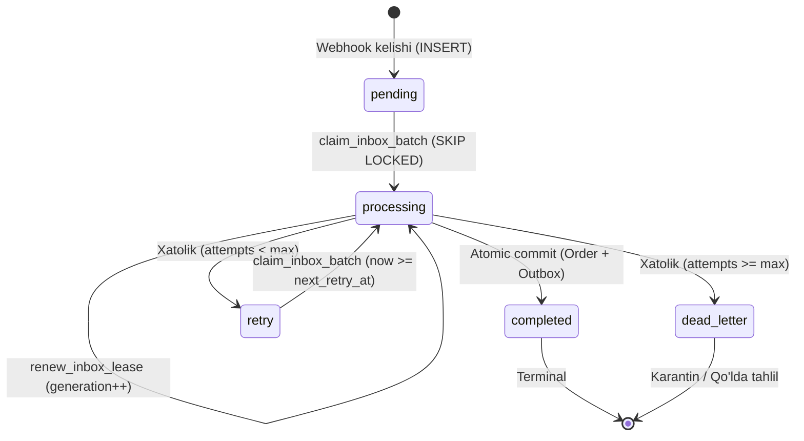
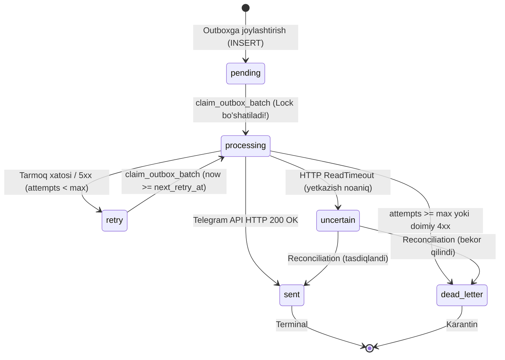

# SELLOI.UZ - PHASE 0.3.1 CANONICAL STATE MACHINE SPECIFICATION

**Loyiha:** Selloi.uz - AI Sales Control Center  
**Audit bosqichi:** Phase 0.3.1  
**Qamrov:** Telegram Durable Inbox va Transactional Outbox holatlar mashinasi  

---

## 1. TELEGRAM INBOX HOLATLAR MASHINASI (INBOX STATE MACHINE)

### 1.1. Holatlar (States)

1. **`pending`**: Webhook orqali qabul qilingan va hali hech bir worker tomonidan olinmagan xabar.
2. **`processing`**: Worker tomonidan lease olingan va ayni paytda qayta ishlanayotgan xabar.
3. **`retry`**: Qayta ishlashda vaqtinchalik xatolik yuz bergan va belgilangan `next_retry_at` vaqtida qayta urinishni kutayotgan xabar.
4. **`completed`**: Biznes mantig'i muvaffaqiyatli bajarilgan, buyurtma yaratilgan/yangilangan va outboxga javob qo'yilgan terminal holat.
5. **`dead_letter`**: Qayta urinishlar soni limitdan (`max_attempts=5`) oshgan yoki zaharli xabar (poison pill) deb topilgan terminal karantin holati.

### 1.2. O'tishlar Matritsasi (Transition Matrix)

| Boshlang'ich Holat | Maqsadli Holat | Tranzaksiya / Trigger | Shartlar va Qoidalar | Qonuniyligi |
|---|---|---|---|---|
| *(boshlang'ich)* | `pending` | Webhook POST qabul qilindi | `update_id` va `bot_id` bo'yicha unikal | Qonuniy |
| `pending` | `processing` | `claim_inbox_batch()` | `lease_token` yangilanadi, `fencing_generation += 1` | Qonuniy |
| `processing` | `completed` | `process_inbox_job_atomically()` | `lease_token` va `fencing_generation` mos kelishi shart | Qonuniy |
| `processing` | `retry` | Biznes xatoligi / tarmoq uzilishi | `attempts < max_attempts`, `next_retry_at` belgilanadi | Qonuniy |
| `processing` | `dead_letter` | `fail_inbox_job()` | `attempts >= max_attempts` yoki bartaraf etib bo'lmas xatolik | Qonuniy |
| `processing` | `processing` | `renew_inbox_lease()` | Uzoq amallarda lease uzaytiriladi, `fencing_generation += 1` | Qonuniy |
| `retry` | `processing` | `claim_inbox_batch()` | `now() >= next_retry_at`, yangi lease olinadi | Qonuniy |
| `completed` | *har qanday* | *istalgan urinish* | Terminal holat. O'zgartirish taqiqlanadi | **TAQIQLANGAN** (`ValueError`) |
| `dead_letter` | `processing` | Avtomatik da'vo | Faqat qo'lda auditdan so'ng ruxsat etiladi | **TAQIQLANGAN** (`ValueError`) |

### 1.3. Inbox Holatlar Diagrammasi

---

## 2. TELEGRAM OUTBOX HOLATLAR MASHINASI (OUTBOX STATE MACHINE)

### 2.1. Holatlar (States)

1. **`pending`**: Biznes jarayoni tomonidan yaratilgan va Telegramga yuborilishini kutayotgan xabar.
2. **`processing`**: Worker tomonidan band qilingan, DB locki bo'shatilgan va HTTP orqali yuborilayotgan xabar.
3. **`retry`**: Telegram API vaqtinchalik 5xx, 429 yoki tarmoq xatosi bergan, qayta urinishni kutayotgan xabar.
4. **`sent`**: Telegram API dan HTTP 200 OK olingan terminal holat.
5. **`dead_letter`**: Urinishlar soni limitdan (`max_attempts=3`) oshgan yoki 400 Bad Request (bot bloklangan, chat topilmadi) olgan xabar.
6. **`uncertain`**: HTTP so'rovida `ConnectTimeout` yoki `ReadTimeout` yuz bergan holat. Xabar yetib borgan yoki bormaganligi noma'lum bo'lgani sababli avtomatik qayta jo'natilmaydi.

### 2.2. O'tishlar Matritsasi (Transition Matrix)

| Boshlang'ich Holat | Maqsadli Holat | Tranzaksiya / Trigger | Shartlar va Qoidalar | Qonuniyligi |
|---|---|---|---|---|
| *(boshlang'ich)* | `pending` | Buyurtma yoki bot javobi yaratildi | Inbox tranzaksiyasi ichida yaratiladi | Qonuniy |
| `pending` | `processing` | `claim_outbox_batch()` | `lease_token` olinadi, **DB lock darhol commit qilinadi** | Qonuniy |
| `processing` | `sent` | `complete_outbox_event()` | Telegram HTTP 200 qaytardi, `sent_at` yoziladi | Qonuniy |
| `processing` | `retry` | `fail_outbox_event(is_timeout=False)` | Tarmoq xatosi, `attempts < max_attempts`, backoff belgilanadi | Qonuniy |
| `processing` | `uncertain` | `fail_outbox_event(is_timeout=True)` | HTTP ReadTimeout yuz berdi, dublikat yuborish xavfi | Qonuniy |
| `processing` | `dead_letter` | `fail_outbox_event()` | `attempts >= max_attempts` yoki doimiy 4xx xatolik | Qonuniy |
| `retry` | `processing` | `claim_outbox_batch()` | `now() >= next_retry_at`, yangi lease olinadi | Qonuniy |
| `uncertain` | `sent` / `retry` | Reconciliation jarayoni | Operator yoki tekshiruvchi skript orqali | Qonuniy |
| `sent` | *har qanday* | *istalgan urinish* | Terminal holat. Qayta yuborish qat'iyan taqiqlanadi | **TAQIQLANGAN** (`ValueError`) |

### 2.3. Outbox Holatlar Diagrammasi

---

## 3. MONOTONIK FENCING VA LEASE MUDDATINI BOSHQARISH QOIDALARI

1. **Lease muddati (TTL):** Standart lease vaqti 60 soniya (`DEFAULT_LEASE_SECONDS = 60`).
2. **Lease yangilash:** Agar vazifa 45 soniyadan ko'proq vaqt talab qilsa, worker `renew_inbox_lease()` chaqirishi shart. Har safar chaqirilganda:
   - `lease_expires_at = now + TTL`
   - `fencing_generation = fencing_generation + 1`
3. **Split-Brain himoyasi:** Agar Worker A lease muddati tugagandan so'ng qayta uyg'onsa va `complete_inbox_job` chaqirsa:
   - Bazadagi joriy yozuv Worker B tomonidan olingan va uning `fencing_generation` qiymati kattaroq bo'ladi.
   - Worker A ning so'rovi WHERE shartiga mos kelmaydi (`affected_rows == 0`).
   - Natijada Worker A hech qanday o'zgarish kirita olmaydi va xavfsiz rad etiladi.

---

## 4. EKPONENTSIAL BACKOFF VA RETRY FORMULASI

Qayta urinishlar uchun kechikish vaqti quyidagi formula bo'yicha hisoblanadi:

$$\text{delay} = \min(300, 2^{\text{attempts}} \times 2) + \text{jitter}$$

- **1-urinish:** $\sim 4$ soniya
- **2-urinish:** $\sim 8$ soniya
- **3-urinish:** $\sim 16$ soniya
- **4-urinish:** $\sim 32$ soniya
- **5-urinishdan so'ng:** `dead_letter` karantiniga o'tkaziladi.
