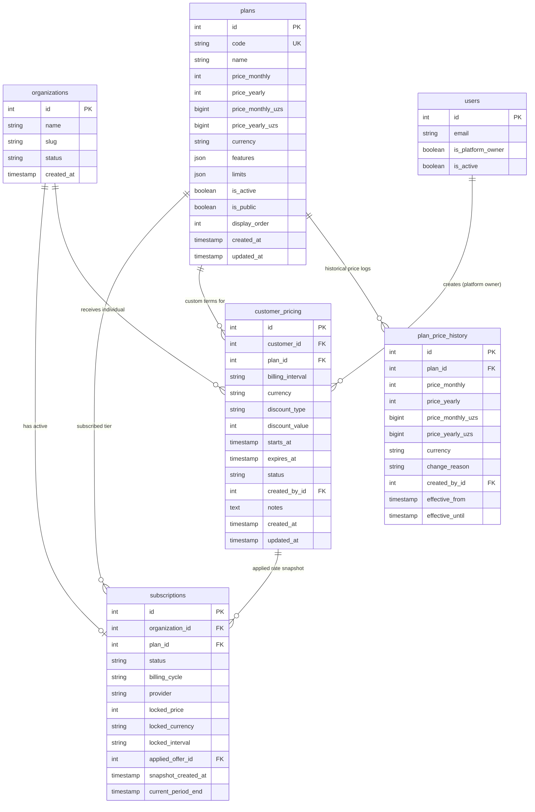

# SELLOI.UZ : HYBRID DYNAMIC PRICING DATABASE ARCHITECTURE SPECIFICATION (REVISION 1.1)

**Document Version:** 1.1.0 (Phase 0 Revision)  
**Status:** SPECIFICATION APPROVED FOR PHASE 1 REVIEW  
**Framework:** Alembic Migration Framework (PostgreSQL 16 + SQLAlchemy 2.0 Async)  
**Security Tier:** Platform Owner Only (`is_platform_owner == True`)  
**Strict Rule:** Zero schema alterations during application startup. Migrations execute strictly via Alembic.  

---

## 1. Relational Architecture & Entity Relationship Diagram

The Selloi Hybrid Dynamic Pricing System establishes an immutable, server-authoritative data layer.
It decouples commercial pricing decisions from frontend code and provides:
1. **Global Plans (`plans`):** Standard catalog pricing for START, PRO, and ULTRA tiers.
2. **Customer-Specific Pricing (`customer_pricing`):** Targeted individual discounts, VIP pricing, and enterprise custom terms assigned to specific tenant organizations.
3. **Immutable Subscription Snapshots (`subscriptions`):** Permanent rate-locking to protect subscribers from unannounced global price changes.
4. **Historical Price Auditing (`plan_price_history`):** Complete chronological trail of every global plan price adjustment.



---

## 2. Model Specifications & DDL

### 2.1. CustomerPricing Model (`customer_pricing`)

The `CustomerPricing` model enables Platform Owners to create customized pricing terms for individual tenant organizations.

#### Attributes & Constraints
- `id`: Integer, Primary Key, Autoincrement.
- `customer_id`: Integer, Foreign Key -> `organizations.id` ON DELETE CASCADE, Index: True.
  - *Architectural Note:* In Selloi B2B SaaS, tenant organizations (`organizations`) represent paying customer entities.
- `plan_id`: Integer, Foreign Key -> `plans.id` ON DELETE RESTRICT, Index: True.
- `billing_interval`: String(16), Values: `'monthly'`, `'yearly'`, `'both'`.
- `currency`: String(8), Default: `'USD'`, Values: `'USD'`, `'UZS'`.
- `discount_type`: String(32), Check Constraint: `discount_type IN ('percentage', 'fixed_amount', 'custom_price')`.
- `discount_value`: Integer NOT NULL (in minor units or whole percent):
  - If `percentage`: integer value between 1 and 100 (e.g. 30 = 30% off).
  - If `fixed_amount`: minor units off catalog price (e.g. 1500 = $15.00 off in USD cents, or tiyin in UZS).
  - If `custom_price`: exact payable rate in minor units (e.g. 4500 = $45.00/mo in USD cents).
- `starts_at`: DateTime(timezone=True) NOT NULL.
- `expires_at`: DateTime(timezone=True) NOT NULL.
- `status`: String(32), Default: `'active'`, Values: `'active'`, `'expired'`, `'revoked'`, `'superseded'`.
- `created_by_id`: Integer, Foreign Key -> `users.id` ON DELETE RESTRICT (must be a Platform Owner).
- `notes`: Text, Optional administrative reasoning for the custom rate.
- `created_at`: DateTime(timezone=True), Default: `utcnow`.
- `updated_at`: DateTime(timezone=True), Default: `utcnow`, OnUpdate: `utcnow`.

#### Anti-Stacking & Collision Prevention
To ensure a customer cannot have multiple conflicting active offers for the same plan and interval, a partial unique index is enforced at the database level:

```sql
CREATE UNIQUE INDEX uq_customer_pricing_active 
ON customer_pricing (customer_id, plan_id, billing_interval) 
WHERE status = 'active';
```

---

### 2.2. Enhancements to Global Plans (`plans`)

Existing `plans` table receives four additional columns to support dual-currency and public catalog display:

```sql
ALTER TABLE plans ADD COLUMN IF NOT EXISTS price_monthly_uzs BIGINT DEFAULT 24500000;
ALTER TABLE plans ADD COLUMN IF NOT EXISTS price_yearly_uzs BIGINT DEFAULT 245000000;
ALTER TABLE plans ADD COLUMN IF NOT EXISTS is_public BOOLEAN DEFAULT TRUE;
ALTER TABLE plans ADD COLUMN IF NOT EXISTS display_order INTEGER DEFAULT 1;

CREATE INDEX IF NOT EXISTS ix_plans_is_public ON plans (is_public);
CREATE INDEX IF NOT EXISTS ix_plans_display_order ON plans (display_order);
```

---

### 2.3. Enhancements to Subscriptions (`subscriptions`)

Existing `subscriptions` table receives rate snapshotting columns:

```sql
ALTER TABLE subscriptions ADD COLUMN IF NOT EXISTS locked_price INTEGER;
ALTER TABLE subscriptions ADD COLUMN IF NOT EXISTS locked_currency VARCHAR(8) DEFAULT 'USD';
ALTER TABLE subscriptions ADD COLUMN IF NOT EXISTS locked_interval VARCHAR(16) DEFAULT 'monthly';
ALTER TABLE subscriptions ADD COLUMN IF NOT EXISTS applied_offer_id INTEGER;
ALTER TABLE subscriptions ADD COLUMN IF NOT EXISTS snapshot_created_at TIMESTAMPTZ DEFAULT CURRENT_TIMESTAMP;

ALTER TABLE subscriptions 
ADD CONSTRAINT fk_subscriptions_applied_offer 
FOREIGN KEY (applied_offer_id) REFERENCES customer_pricing(id) ON DELETE SET NULL;

CREATE INDEX IF NOT EXISTS ix_subscriptions_applied_offer_id ON subscriptions (applied_offer_id);
```

---

### 2.4. Global Plan Price History (`plan_price_history`)

Stores historical versions of global plan prices whenever the Platform Owner modifies pricing:

```sql
CREATE TABLE IF NOT EXISTS plan_price_history (
    id SERIAL PRIMARY KEY,
    plan_id INTEGER NOT NULL REFERENCES plans(id) ON DELETE CASCADE,
    price_monthly INTEGER NOT NULL,
    price_yearly INTEGER NOT NULL,
    price_monthly_uzs BIGINT NOT NULL,
    price_yearly_uzs BIGINT NOT NULL,
    currency VARCHAR(8) NOT NULL DEFAULT 'USD',
    change_reason VARCHAR(255) DEFAULT '',
    created_by_id INTEGER REFERENCES users(id) ON DELETE SET NULL,
    effective_from TIMESTAMPTZ NOT NULL DEFAULT CURRENT_TIMESTAMP,
    effective_until TIMESTAMPTZ NULL,
    created_at TIMESTAMPTZ NOT NULL DEFAULT CURRENT_TIMESTAMP
);

CREATE INDEX IF NOT EXISTS ix_plan_price_history_plan_id ON plan_price_history (plan_id);
CREATE INDEX IF NOT EXISTS ix_plan_price_history_effective_from ON plan_price_history (effective_from);
```

---

## 3. Currency and Monetary Precision Standards

### 3.1. Zero Floating-Point Arithmetic Rule
Floating-point data types (`float`, `double`, `real`) are strictly prohibited in all financial models and billing services.
All values are stored as integers representing minor currency units:

| Currency | Unit of Account | Minor Unit Name | Conversion | Storage Type | Example Representation |
| :--- | :--- | :--- | :--- | :--- | :--- |
| **USD** | US Dollar | Cent | 1 USD = 100 Cents | `Integer` | `$19.00` stored as `1900` |
| **UZS** | Uzbek So'm | Tiyin | 1 UZS = 100 Tiyin | `BigInteger` | `245,000 UZS` stored as `24,500,000` |

### 3.2. Explicit Dual-Currency Storage
The system never performs dynamic, unpredictable runtime exchange rate conversions between USD and UZS.
The Platform Owner sets and approves explicit rates in both currencies.
If a customer chooses UZS billing, the system charges the exact `price_monthly_uzs` value defined in the database without floating-point drift.

### 3.3. Financial Rounding Specification
When calculating percentage discounts:
```python
from decimal import Decimal, ROUND_HALF_UP

def calculate_discounted_amount(base_cents: int, discount_percent: int) -> int:
    base = Decimal(base_cents)
    percent = Decimal(discount_percent)
    discount = (base * (percent / Decimal(100))).quantize(Decimal("1"), rounding=ROUND_HALF_UP)
    return int(max(Decimal(0), base - discount))
```

---

## 4. Alembic Migration Implementation

### 4.1. Migration Principles
1. **No Startup Schema Modification:** Application initialization (`app.main:lifespan`) must NEVER execute DDL statements or `create_all()`. Startup is strictly read-only schema validation.
2. **Deterministic Version Ordering:** The migration script hooks into the existing Alembic chain:
   - `down_revision = '3d38b39cf960'` (the existing `init_schema` migration).
   - `revision = '4e82f1b8a910'`.
3. **Idempotency & Zero Downtime:** Every DDL operation uses `IF NOT EXISTS` and non-locking column additions.

### 4.2. Alembic Migration Script (`alembic/versions/4e82f1b8a910_hybrid_pricing_system.py`)

```python
"""hybrid pricing system

Revision ID: 4e82f1b8a910
Revises: 3d38b39cf960
Create Date: 2026-11-20 10:00:00.000000

"""
from typing import Sequence, Union
from alembic import op
import sqlalchemy as sa


revision: str = '4e82f1b8a910'
down_revision: Union[str, Sequence[str], None] = '3d38b39cf960'
branch_labels: Union[str, Sequence[str], None] = None
depends_on: Union[str, Sequence[str], None] = None


def upgrade() -> None:
    # 1. Enhance plans table
    op.add_column('plans', sa.Column('price_monthly_uzs', sa.BigInteger(), nullable=False, server_default='24500000'))
    op.add_column('plans', sa.Column('price_yearly_uzs', sa.BigInteger(), nullable=False, server_default='245000000'))
    op.add_column('plans', sa.Column('is_public', sa.Boolean(), nullable=False, server_default=sa.text('true')))
    op.add_column('plans', sa.Column('display_order', sa.Integer(), nullable=False, server_default='1'))
    op.create_index(op.f('ix_plans_is_public'), 'plans', ['is_public'], unique=False)
    op.create_index(op.f('ix_plans_display_order'), 'plans', ['display_order'], unique=False)

    # 2. Create customer_pricing table
    op.create_table(
        'customer_pricing',
        sa.Column('id', sa.Integer(), autoincrement=True, nullable=False),
        sa.Column('customer_id', sa.Integer(), nullable=False),
        sa.Column('plan_id', sa.Integer(), nullable=False),
        sa.Column('billing_interval', sa.String(length=16), nullable=False, server_default='monthly'),
        sa.Column('currency', sa.String(length=8), nullable=False, server_default='USD'),
        sa.Column('discount_type', sa.String(length=32), nullable=False),
        sa.Column('discount_value', sa.Integer(), nullable=False),
        sa.Column('starts_at', sa.DateTime(timezone=True), nullable=False),
        sa.Column('expires_at', sa.DateTime(timezone=True), nullable=False),
        sa.Column('status', sa.String(length=32), nullable=False, server_default='active'),
        sa.Column('created_by_id', sa.Integer(), nullable=False),
        sa.Column('notes', sa.Text(), nullable=True),
        sa.Column('created_at', sa.DateTime(timezone=True), nullable=False, server_default=sa.func.now()),
        sa.Column('updated_at', sa.DateTime(timezone=True), nullable=False, server_default=sa.func.now()),
        sa.ForeignKeyConstraint(['customer_id'], ['organizations.id'], ondelete='CASCADE'),
        sa.ForeignKeyConstraint(['plan_id'], ['plans.id'], ondelete='RESTRICT'),
        sa.ForeignKeyConstraint(['created_by_id'], ['users.id'], ondelete='RESTRICT'),
        sa.PrimaryKeyConstraint('id'),
        sa.CheckConstraint("discount_type IN ('percentage', 'fixed_amount', 'custom_price')", name='ck_customer_pricing_discount_type'),
        sa.CheckConstraint("billing_interval IN ('monthly', 'yearly', 'both')", name='ck_customer_pricing_billing_interval'),
        sa.CheckConstraint("status IN ('active', 'expired', 'revoked', 'superseded')", name='ck_customer_pricing_status')
    )
    op.create_index(op.f('ix_customer_pricing_customer_id'), 'customer_pricing', ['customer_id'], unique=False)
    op.create_index(op.f('ix_customer_pricing_plan_id'), 'customer_pricing', ['plan_id'], unique=False)
    op.create_index(op.f('ix_customer_pricing_status'), 'customer_pricing', ['status'], unique=False)

    # Partial unique index to prevent conflicting active offers
    op.execute("""
        CREATE UNIQUE INDEX uq_customer_pricing_active 
        ON customer_pricing (customer_id, plan_id, billing_interval) 
        WHERE status = 'active';
    """)

    # 3. Create plan_price_history table
    op.create_table(
        'plan_price_history',
        sa.Column('id', sa.Integer(), autoincrement=True, nullable=False),
        sa.Column('plan_id', sa.Integer(), nullable=False),
        sa.Column('price_monthly', sa.Integer(), nullable=False),
        sa.Column('price_yearly', sa.Integer(), nullable=False),
        sa.Column('price_monthly_uzs', sa.BigInteger(), nullable=False),
        sa.Column('price_yearly_uzs', sa.BigInteger(), nullable=False),
        sa.Column('currency', sa.String(length=8), nullable=False, server_default='USD'),
        sa.Column('change_reason', sa.String(length=255), nullable=True, server_default=''),
        sa.Column('created_by_id', sa.Integer(), nullable=True),
        sa.Column('effective_from', sa.DateTime(timezone=True), nullable=False, server_default=sa.func.now()),
        sa.Column('effective_until', sa.DateTime(timezone=True), nullable=True),
        sa.Column('created_at', sa.DateTime(timezone=True), nullable=False, server_default=sa.func.now()),
        sa.ForeignKeyConstraint(['plan_id'], ['plans.id'], ondelete='CASCADE'),
        sa.ForeignKeyConstraint(['created_by_id'], ['users.id'], ondelete='SET NULL'),
        sa.PrimaryKeyConstraint('id')
    )
    op.create_index(op.f('ix_plan_price_history_plan_id'), 'plan_price_history', ['plan_id'], unique=False)
    op.create_index(op.f('ix_plan_price_history_effective_from'), 'plan_price_history', ['effective_from'], unique=False)

    # 4. Enhance subscriptions table with rate snapshots
    op.add_column('subscriptions', sa.Column('locked_price', sa.Integer(), nullable=True))
    op.add_column('subscriptions', sa.Column('locked_currency', sa.String(length=8), nullable=False, server_default='USD'))
    op.add_column('subscriptions', sa.Column('locked_interval', sa.String(length=16), nullable=False, server_default='monthly'))
    op.add_column('subscriptions', sa.Column('applied_offer_id', sa.Integer(), nullable=True))
    op.add_column('subscriptions', sa.Column('snapshot_created_at', sa.DateTime(timezone=True), nullable=False, server_default=sa.func.now()))
    op.create_foreign_key('fk_subscriptions_applied_offer', 'subscriptions', 'customer_pricing', ['applied_offer_id'], ['id'], ondelete='SET NULL')
    op.create_index(op.f('ix_subscriptions_applied_offer_id'), 'subscriptions', ['applied_offer_id'], unique=False)

    # 5. Backfill existing subscriptions with their current plan prices
    op.execute("""
        UPDATE subscriptions s
        SET locked_price = CASE 
            WHEN s.billing_cycle = 'yearly' THEN p.price_yearly * 100 
            ELSE p.price_monthly * 100 
        END,
        locked_currency = p.currency,
        locked_interval = s.billing_cycle,
        snapshot_created_at = CURRENT_TIMESTAMP
        FROM plans p
        WHERE s.plan_id = p.id AND s.locked_price IS NULL;
    """)

    # Make locked_price NOT NULL after backfill
    op.alter_column('subscriptions', 'locked_price', nullable=False)


def downgrade() -> None:
    # 1. Revert subscriptions
    op.drop_constraint('fk_subscriptions_applied_offer', 'subscriptions', type_='foreignkey')
    op.drop_index(op.f('ix_subscriptions_applied_offer_id'), table_name='subscriptions')
    op.drop_column('subscriptions', 'snapshot_created_at')
    op.drop_column('subscriptions', 'applied_offer_id')
    op.drop_column('subscriptions', 'locked_interval')
    op.drop_column('subscriptions', 'locked_currency')
    op.drop_column('subscriptions', 'locked_price')

    # 2. Revert plan_price_history
    op.drop_index(op.f('ix_plan_price_history_effective_from'), table_name='plan_price_history')
    op.drop_index(op.f('ix_plan_price_history_plan_id'), table_name='plan_price_history')
    op.drop_table('plan_price_history')

    # 3. Revert customer_pricing
    op.execute("DROP INDEX IF EXISTS uq_customer_pricing_active;")
    op.drop_index(op.f('ix_customer_pricing_status'), table_name='customer_pricing')
    op.drop_index(op.f('ix_customer_pricing_plan_id'), table_name='customer_pricing')
    op.drop_index(op.f('ix_customer_pricing_customer_id'), table_name='customer_pricing')
    op.drop_table('customer_pricing')

    # 4. Revert plans
    op.drop_index(op.f('ix_plans_display_order'), table_name='plans')
    op.drop_index(op.f('ix_plans_is_public'), table_name='plans')
    op.drop_column('plans', 'display_order')
    op.drop_column('plans', 'is_public')
    op.drop_column('plans', 'price_yearly_uzs')
    op.drop_column('plans', 'price_monthly_uzs')
```

---

## 5. Pre-Migration Backup & Rollback Protocol

### 5.1. Backup Procedure Before Execution
Prior to applying the Alembic migration on production:
```bash
# 1. Create a compressed binary snapshot
pg_dump -Fc -h localhost -U postgres -d selloi_production > /var/backups/selloi_pre_pricing_$(date +%Y%m%d_%H%M%S).dump

# 2. Verify archive validity
pg_restore --list /var/backups/selloi_pre_pricing_*.dump | head -n 30
```

### 5.2. Rollback Execution Command
If any failure occurs during Phase 1 deployment:
```bash
# Systematic rollback to previous schema version
alembic downgrade 3d38b39cf960
```
This cleanly drops all added columns, constraints, and tables in reverse dependency order without data corruption to other tables.
